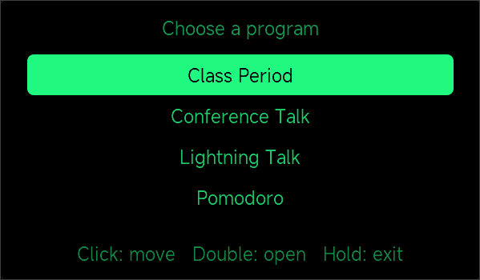
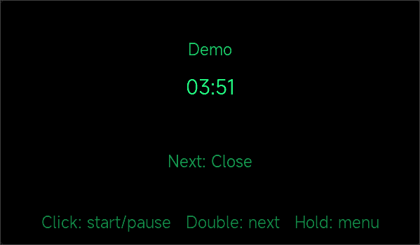
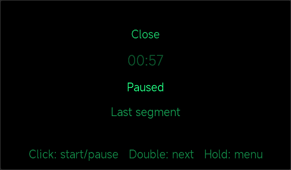
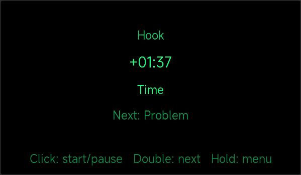
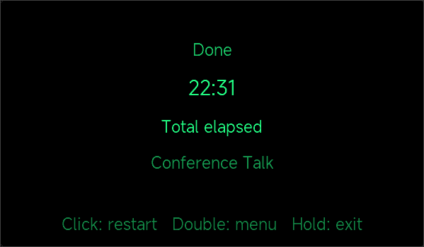

# Talk Timer

A segmented presentation and classroom timer for MemoMind glasses, written as
a native glasses plugin (`.gmp`) with the MemoMind Glass SDK.

Pick a program at launch, then run through its segments with the glasses
button: a large countdown, the current segment name, and what comes next.
Manual programs count overtime when a segment runs long, and auto programs
(like Pomodoro) flow straight into the next segment. "Quiet" segments shrink the
display to a small countdown in the corner so it stays out of the way while you
focus.

| | |
| --- | --- |
| Plugin ID | `com.dov.talk-timer` |
| Version | 3 |
| Platform | Glasses only (no phone companion) |
| ABI version | 256 |

## Screenshots

Captured in MemoMind Plugin Studio's glasses simulator.

| | |
| --- | --- |
|  |  |
| **Program menu.** Click to move, double-click to open. | **Running timer.** Segment, countdown, and what's next. |
|  |  |
| **Paused.** The countdown dims, and the last segment is flagged. | **Overtime.** Manual programs count up past 0:00. |
|  |  |
| **Quiet segment.** Pomodoro focus shows only a small corner countdown. | **Done.** Total elapsed time for the program. |

## Download

The latest build is attached to the
[Releases](../../releases) page:

- `talk-timer-review.zip`: the package exported by MemoMind Plugin Studio
  (GMP, review metadata, and source encrypted with MemoMind's review key)
- `talk_timer.gmp`: the plain plugin binary

## Programs

| Program | Advance | Segments (minutes) |
| --- | --- | --- |
| Class Period | manual | Warm-up 5, Mini-lesson 10, Activity 20, Share-out 7, Wrap-up 3 |
| Conference Talk | manual | Hook 2, Problem 4, Main idea 8, Demo 4, Close 2 |
| Lightning Talk | manual | Hook 1, Point 3, Close 1 |
| Pomodoro | auto | Focus 25 (quiet) / Break 5, four rounds, final break 15 |

- **Manual programs** show "Time" at 0:00 and count overtime as `+mm:ss` until
  you move to the next segment.
- **Auto programs** advance on their own and keep running.
- When the last segment ends, a **Done** screen shows the total elapsed time.

## Controls

Everything runs from the single primary button.

| Button | Menu | Timer | Done |
| --- | --- | --- | --- |
| Single click | Move highlight (wraps) | Start / pause | Restart program |
| Double click | Open program (paused at segment 1) | Next segment | Back to menu |
| Long press | Exit | Back to menu | Exit |

The menu, timer and Done screens show a one-line control hint at the bottom.
Quiet segments show only the countdown.

## Design notes

- **Programs are data.** Each program is a name, an auto-advance flag and a
  list of segments, each with a label, minutes and a style (normal or quiet).
  The timer reads only the selected program, so programs could later come from
  a phone companion without changing the timer logic.
- **One input mapping.** Raw button events are translated in one function into
  three named actions (next, select, back). Each screen handles only those
  actions, and hidden screens never receive input.
- **Resolution-independent layout.** Geometry comes from `display_get_info` and
  text is sized with the Host's font measurement, with no hard-coded pixel
  sizes. Shorter hint text is used automatically if the long version doesn't fit.
- **Light on the display.** Labels cache their current text and style, and
  only changed labels are redrawn.
- **Accurate time.** Time advances only from the Host's `elapsed_ms`. Auto
  programs carry any overshoot into the next segment.
- **Clean lifecycle.** All UI is created on start and released on stop. The
  shared call-screen helper hides the plugin during a phone call screen.
- **Small footprint.** The largest function stack frame is 96 B (limit 1024 B),
  with 5,228 B of Flash and 1,288 B of static RAM.

## Building from source

The plugin builds inside the public
[MemoMind Plugin Open Platform](https://open-platform.memo-mind.com) SDK. It
uses the SDK's shared `examples/common/call_ui.h`, so it lives in the examples
folder:

1. Copy `talk_timer.c` and `manifest.json` into
   `GlassSDK/examples/talk_timer/` in your SDK checkout.
2. From the SDK root, build the glasses plugins:

   ```sh
   # Windows PowerShell
   py build.py glass

   # macOS / Linux
   ./build.py glass
   ```

3. The output is in `GlassSDK/build-host/.build/talk_timer/`.
4. In MemoMind Plugin Studio, refresh the workspace and select **Talk Timer**
   as the glasses plugin, with no phone plugin.

### Dev mode

`#define DEV_FAST_TIME 0` near the top of `talk_timer.c` controls a testing
mode. Set it to `1` to make every "minute" last one second and show a "DEV"
marker on screen, then rebuild. Release builds use `0`.

## License

Talk Timer's source is by the author of this repository. It is built with the
MemoMind Glass SDK, whose use is subject to the
[MemoMind Open Platform Terms](https://open-platform.memo-mind.com/terms).
